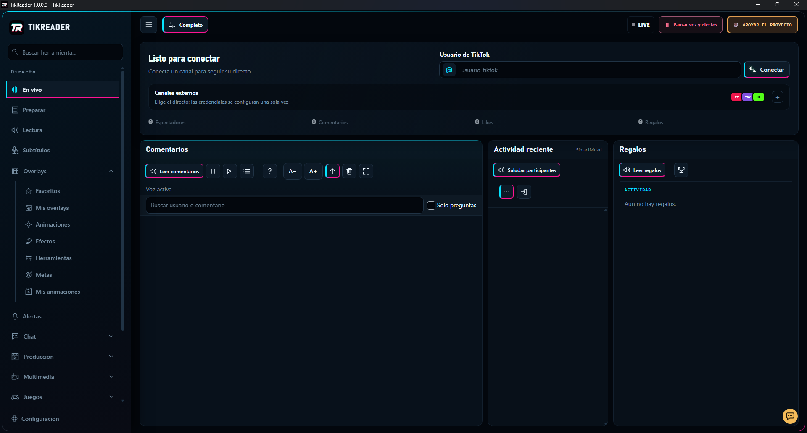
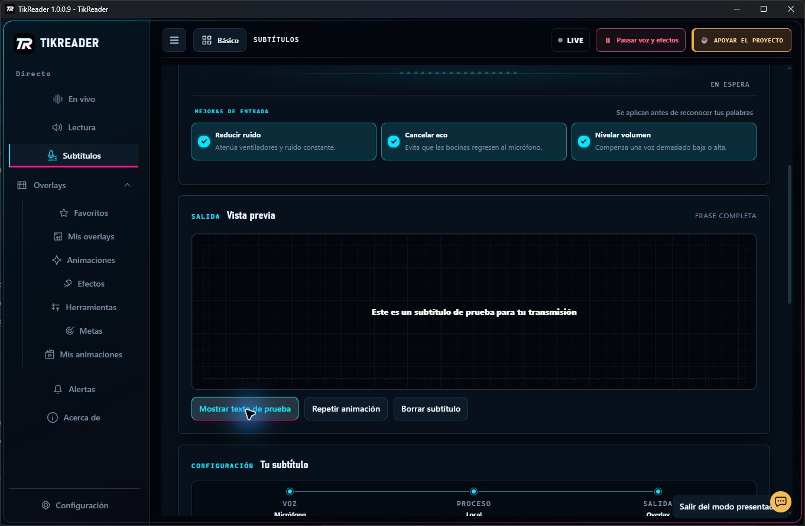
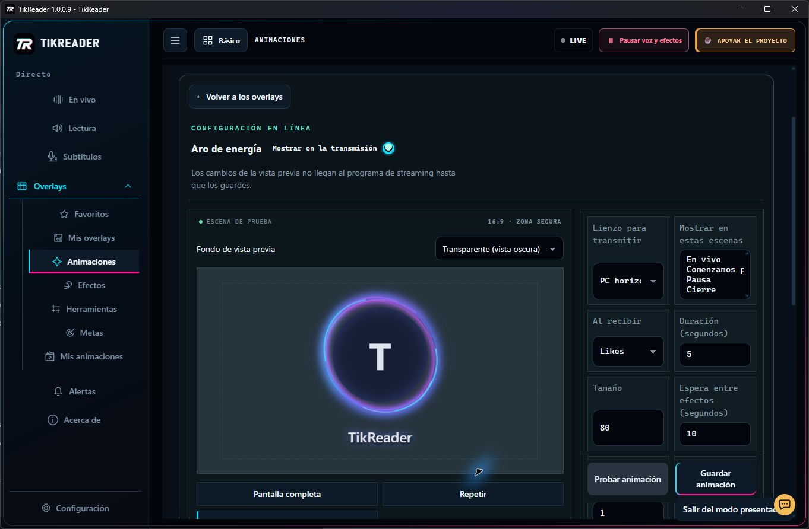

  
  <h1>TikReader</h1>
  
<strong>A Windows desktop studio for live chat, voice, and stream overlays.</strong>

  
Bring TikTok LIVE, YouTube Live, and Twitch into one operator workspace.

  

    
    
  

  
<a href="docs/BETA_INSTALACION.md">Installation guide</a> · <a href="docs/INSTRUCCIONES.md">User manual</a> · <a href="https://github.com/3rror32/TikReader/issues">Report a problem</a>

## What’s new in 1.0.0.9

- **Local microphone captions:** Recognize speech on this computer, preview styled captions, and send them to a browser-source overlay. Microphone audio stays local to TikReader.
- **Voice ripples:** Add a live visual response to microphone audio and adjust its appearance in the overlay tools.
- **A clearer desktop startup:** Follow the startup readiness flow and resolve local setup steps before connecting a live channel.
- **Minecraft controls:** Map gifts to Java or Bedrock actions, choose action groups and quantities, and inspect command results. A Minecraft world or server must be configured for live actions.
- **Overlay animation controls:** Preview animations and adjust their triggers, timing, size, colors, sound, and motion before saving.
- **Gift bank and simulation catalog:** Curate the gift bank, map gifts to actions, and prepare test comments or gifts in the simulator. Simulation events can run configured actions, so review those mappings before sending a test.
- **Shared operator workspace:** Use the live chat, activity, gifts, search, and voice controls from one consistent desktop interface.

## Install

TikReader is a **Windows 10/11 x64 beta**. The desktop installer includes its Python runtime and embedded web engine; a separate Python installation or browser is not needed for the desktop interface. Live platform connections and optional model downloads require internet access.

1. Check the [GitHub Releases page](https://github.com/3rror32/TikReader/releases) for an available Windows beta. This README does not announce a 1.0.0.9 release.
2. If a release is available, download its `TikReader-<version>-Beta-Setup.exe` asset, close TikReader, and run the installer.
3. Launch **TikReader** from the Start menu, test a voice, and connect a live channel.

If a public release is not listed, the beta is still being prepared. GitHub’s source ZIP is for developers and is not the Windows installer. See the [installation guide](docs/BETA_INSTALACION.md) for data locations, updates, and optional voices.

## Platforms and integrations

| Integration | TikReader provides | Requirements and status |
| --- | --- | --- |
| TikTok LIVE | Comments, observable gifts, and live events | Availability depends on TikTok, the network, and the connector; restricted streams are not guaranteed. |
| YouTube Live | Chat, observable memberships, and Super Chats | Your own YouTube Data API access and a live video. |
| Twitch | Read channel chat | Twitch account and an authorized chat-read token. |
| OBS Studio | Browser-source overlays and optional scene/source control | Local OBS WebSocket v5 for direct control; explicitly enable changes. |
| TikTok LIVE Studio | Browser-source overlay URLs | Configure compatible sources in your broadcasting setup; this is not direct LIVE Studio control. |
| Spotify | Song-link requests, manual approval, and queue control | Experimental; your Client ID, Premium account, and an active device. Real-account validation remains pending. |
| Minecraft Java | Authorized RCON command aliases | Experimental; a configured server and explicit authorization. Real-server validation remains pending. |
| Streamer.bot | Local HTTP action bridge | Experimental; a configured action GUID and local HTTP server. Real-instance validation remains pending. |

These connectors are implemented capabilities; this does not mean every external service has been validated during a real broadcast. See [operating instructions](docs/INSTRUCCIONES.md) and [physical validation notes](docs/VALIDACION_FISICA.md). TikReader is an independent project and is not affiliated with the platforms listed above.

## Voice and local processing

Computer voices depend on the voices available on your system. Kokoro is optional; its first download requires internet access, and later synthesis runs locally. The included Spanish Vosk model supports microphone captions. Whisper caption models are also available for local recognition. Custom RVC models and the RVC/CUDA environment require separate setup and compatible hardware.

See [voice requirements and installation](docs/BETA_INSTALACION.md) and [local voice licenses](docs/LOCAL_TTS_LICENSES.md). Platform connections and optional model downloads still use the network.

## Documentation and development

- [Documentation hub](docs/README.md)
- [Studio, audience, and community features](docs/ESTUDIO_Y_COMUNIDAD.md)
- [Simulation](docs/SIMULACION.md) and [recovery](docs/RECUPERACION.md)
- [Project structure](docs/ESTRUCTURA.md) and [overlay architecture](docs/OVERLAYS_VISUALES.md)
- [Beta release notes](docs/BETA_RELEASE_NOTES.md) and [maintainer release checklist](docs/BETA_RELEASE_CHECKLIST.md)

To work from source, follow the documentation hub. For a normal installation, use the Windows installer. Contributions and bug reports should include the app version and steps to reproduce; remove credentials and personal chat data from attachments.

## Support TikReader

If TikReader helps your streams, [buy the project a coffee on Ko-fi](https://ko-fi.com/3rror32). Thank you for supporting its development.

Third-party components retain their own licenses. See the [bundled license information](packaging/licenses/VOICES.md); no project-wide license is asserted here.
