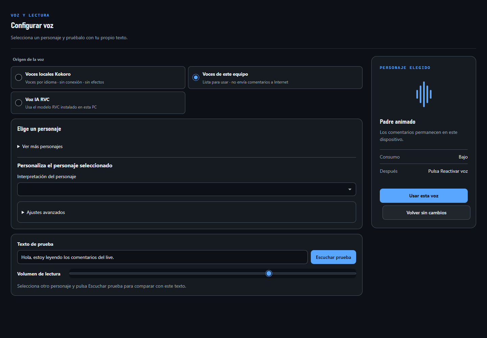
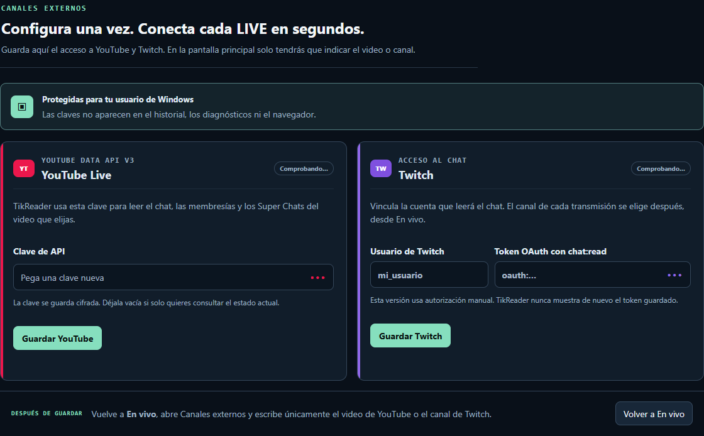

  
  <h1>TikReader</h1>
  
<strong>Your LIVE chat, voices, and overlays in one Windows studio.</strong>

  
Bring TikTok LIVE, YouTube Live, and Twitch into a shared creative workspace.

  

    
    
  

  
<a href="docs/BETA_INSTALACION.md">Installation guide</a> · <a href="docs/INSTRUCCIONES.md">User manual</a> · <a href="https://github.com/3rror32/TikReader/issues">Report a problem</a>

## Create a more interactive LIVE

- **One chat workspace:** follow comments from TikTok LIVE, YouTube Live, and Twitch, with platform labels, filters, and history.
- **Give chat a voice:** try your computer's voices, optional local Kokoro voices, or separately configured RVC models.
- **Build your broadcast:** browser-source overlays, visual effects, audience points, chat games, and event automations.
- **Prepare before going live:** use simulation, diagnostics, profiles, and configurable appearance.

TikReader is a **Windows 10/11 x64 beta**. The desktop installer includes its Python runtime and embedded web engine. You do not need a separate Python installation or browser for the desktop interface. Live platforms require internet access.

## Download and start

1. Open [Releases](https://github.com/3rror32/TikReader/releases) and choose an available Windows beta.
2. Download its `TikReader-<version>-Beta-Setup.exe` asset, close any running TikReader, and run the installer.
3. Launch **TikReader** from the Start menu, test a voice, and connect a live channel.

If no public release is listed yet, the first beta is still being prepared. GitHub's source ZIP is for developers and is not the Windows installer. See the [installation guide](docs/BETA_INSTALACION.md) for data locations, updates, and optional voices.

## Connected platforms and tools

| Integration | What TikReader provides | Requirements and beta status |
| --- | --- | --- |
| TikTok LIVE | Comments, observable gifts and live events | Availability depends on TikTok, your network, and the connector; restricted streams are not guaranteed. |
| YouTube Live | Chat, observable memberships and Super Chats | Your own YouTube Data API access and a live video. |
| Twitch | Read channel chat | Twitch account and authorized chat-read token. |
| OBS Studio | Browser-source overlays and optional scene/source control | Local OBS WebSocket v5 for direct control; explicitly enable changes. |
| TikTok LIVE Studio | Browser-source overlay URLs | Configure compatible sources in your broadcasting setup; this is not direct LIVE Studio control. |
| Spotify | Song-link requests, manual approval, and queue control | Experimental; your Client ID, Premium account, and active device. Real-account validation remains pending. |
| Minecraft Java | Authorized RCON command aliases | Experimental; configured server and explicit authorization. Real-server validation remains pending. |
| Streamer.bot | Local HTTP action bridge | Experimental; configured action GUID and local HTTP server. Real-instance validation remains pending. |

These connectors are implemented capabilities, not a claim that every external service has been validated in a real broadcast. See [operating instructions](docs/INSTRUCCIONES.md) and [physical validation](docs/VALIDACION_FISICA.md). TikReader is an independent project and is not affiliated with the platforms listed above.

## Voices and local processing

Computer voices depend on the voices available on your system. Kokoro is an optional download; subsequent synthesis runs locally. The included Spanish Vosk model supports microphone captions. Custom RVC models and the RVC/CUDA environment require separate setup and compatible hardware.

See [voice requirements and installation](docs/BETA_INSTALACION.md) and [local voice licenses](docs/LOCAL_TTS_LICENSES.md). Platform connections and optional downloads still use the network.

## Documentation and development

- [Documentation hub](docs/README.md)
- [Studio, audience, and community features](docs/ESTUDIO_Y_COMUNIDAD.md)
- [Simulation](docs/SIMULACION.md) and [recovery](docs/RECUPERACION.md)
- [Project structure](docs/ESTRUCTURA.md) and [overlay architecture](docs/OVERLAYS_VISUALES.md)
- [Beta release notes](docs/BETA_RELEASE_NOTES.md) and [maintainer release checklist](docs/BETA_RELEASE_CHECKLIST.md)

To work from source, follow the documentation hub. For a normal installation, use the Windows installer. Contributions and bug reports should include the app version and steps to reproduce; remove credentials and personal chat data from attachments.

## Support TikReader

If TikReader helps your streams, [buy the project a coffee on Ko-fi](https://ko-fi.com/3rror32). Thank you for supporting its development.

Third-party components retain their own licenses. See the [bundled license information](packaging/licenses/VOICES.md); no project-wide license is asserted here.
